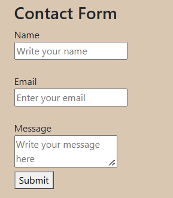
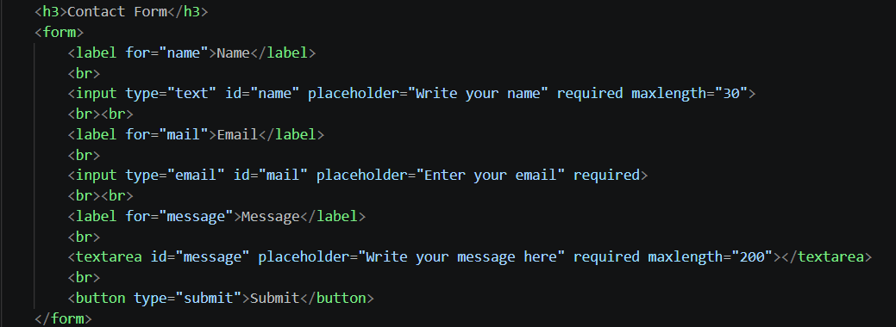
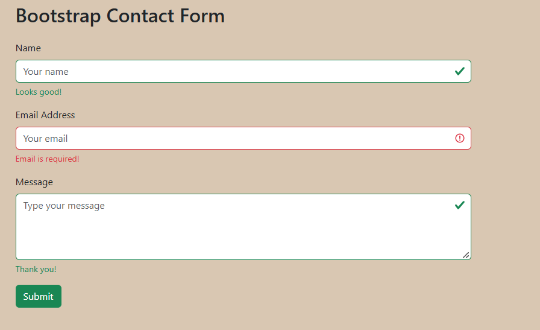
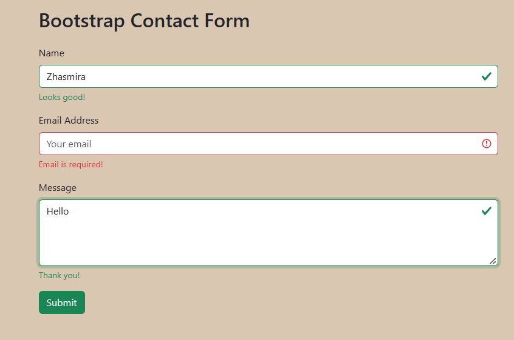
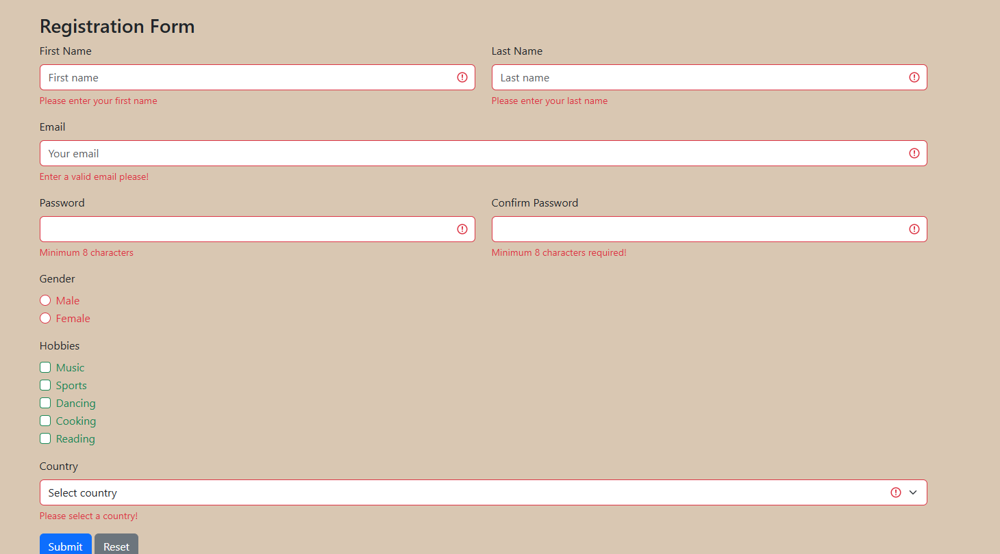

## Zhasmira Mamyrbayeva
## SE-2539
## Description
This project demonstrates how to create forms with HTML and style them using Bootstrap form components.

### Task 0
I created basic contact form with name, email, message fields and a submit button. Each field has a properly connected label.

## Task 1
In this task, I added HTML5 validation attributes such as required, type="email", and maxlength. These attributes help prevent empty fields and invalid email addresses.

### Task 2
I created another contact form using bootstrap 5 classes. Added styled input fields, placeholders, spacing, and responsive layout.

### Task 3
I implemented bootstrap validation feedback to display error and success messages. Invalid fields are highlighted in red, while valid fields turn green.

## Task 4
I created a responsive registration form using bootstrap grid and added HTML5 validation and bootstrap feedback messages for valid and invalid inputs.

## Conlusion
In this project I learned how to create different types of forms, apply HTML5 validation, use Bootstrap for responsive layouts, and display validation feedback.